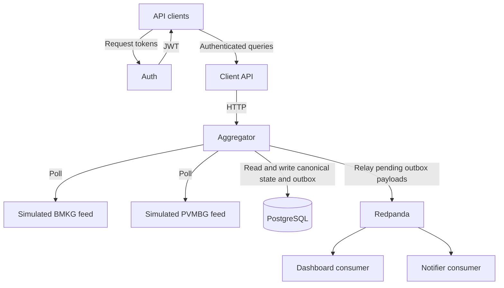

# BNPB Disaster Coordination Platform

A distributed-systems course project that brings earthquake, tsunami-warning, and volcanic reports into a single hazard API and event stream.

Built for **IF4031 — Arsitektur Aplikasi Terdistribusi**, the project models a disaster-coordination platform for Indonesia's **Badan Nasional Penanggulangan Bencana (BNPB)**. The local application uses simulated agency feeds; it is an educational prototype, not an operational emergency-warning service.

## What it does

- **Combines different data sources.** Polls simulated BMKG earthquake and tsunami feeds and PVMBG volcanic reports, then normalizes them into a common hazard model.
- **Enriches and stores reports.** Adds volcano names and coordinates from a reference catalog and stores source-specific attributes in PostgreSQL JSONB. Additive PVMBG fields can be retained without changing database columns.
- **Controls access to detail.** Media clients receive summaries; field and internal clients can request coordinates and raw attributes using short-lived JWTs.
- **Separates ingestion from downstream processing.** A transactional outbox publishes canonical hazard payloads to Redpanda, where independent consumers count incidents and log notification decisions.
- **Keeps existing data useful during upstream outages.** Queries read the canonical store rather than waiting on agency feeds, with metadata indicating upstream degradation.

## Architecture

The application has seven independent Go modules. Services communicate through HTTP or Kafka-compatible messaging, rather than importing one another's code. Only the Aggregator accesses canonical PostgreSQL storage.



| Component | Responsibility |
| :--- | :--- |
| [Aggregator](services/aggregator/README.md) | Polling, normalization, volcano enrichment, persistence, internal hazard queries, and outbox publishing |
| [Auth](services/auth/README.md) | Client authentication, JWT issuance, and refresh-token rotation |
| [Client API](services/client-api/README.md) | Public HTTP API, JWT verification, query validation, and summary/full-field projection |
| [Mock BMKG](services/mock-bmkg/README.md) | Simulated seismic events and tsunami warnings |
| [Mock PVMBG](services/mock-pvmbg/README.md) | Simulated volcanic reports, additive-schema changes, latency, and outages |
| [Consumers](services/consumers/README.md) | Separate consumer groups for in-memory incident counts and logged alert decisions |

**Stack:** Go 1.22, standard-library HTTP servers, PostgreSQL 16 with `pgx`, Redpanda with `kafka-go`, and HS256 JWTs with `jwt/v5`.

## Try it locally

You need Docker Engine and Docker Compose v2. Git is needed to clone the repository; Go is only needed to run tests or services outside Docker.

```bash
git clone https://github.com/Darsua/AAT.git
cd AAT
cp .env.example .env
docker compose up -d --build
```

Review `.env` before starting. Compose includes development-only credential fallbacks and publishes several services to the host; do not expose this setup to an untrusted network or reuse its example credentials in a real deployment. Keep `.env` out of version control.

Check startup and the public API's health:

```bash
docker compose ps
curl --fail http://localhost:8080/health
```

The mocks start with historical reports and generate new ones every ten seconds. Allow time for the first polling cycle before querying hazards. The [local development guide](docs/development.md) covers authentication, API examples, configuration, and troubleshooting.

### Local endpoints

These are the default Compose addresses; host ports can be changed through configuration.

| Endpoint | Address |
| :--- | :--- |
| Hazard list | `GET http://localhost:8080/api/v1/hazards` |
| Hazard details | `GET http://localhost:8080/api/v1/hazards/{id}` |
| Token issuance | `POST http://localhost:8084/auth/token` |
| Token refresh | `POST http://localhost:8084/auth/refresh` |
| Mock BMKG | `http://localhost:8081` |
| Mock PVMBG | `http://localhost:8082` |
| Kafka-compatible broker | `localhost:19092` |

Hazard queries require a Bearer JWT. `fields=summary` is the default; `fields=all` requires the full-read scope. The database has no published host port. For internal Aggregator diagnostics, use a container on the Compose network:

```bash
docker compose exec -T client-api curl --fail http://aggregator:8083/health
```

Stop the stack while retaining its database and broker volumes:

```bash
docker compose down
```

**To delete local data as well**, use `docker compose down -v`. The `make down` shortcut also deletes those volumes.

## Project status

The runnable Compose application is the **Milestone 1 baseline**. Work toward the multi-node Kubernetes system in **Milestone 2** is tracked in [GitHub issues](https://github.com/Darsua/AAT/issues).

| Area | Current repository status |
| :--- | :--- |
| BMKG/PVMBG ingestion, hazard reads, authentication, and event consumers | Implemented baseline |
| Satellite/coastal hazard types, field-report submission, and Audit API | M2 contract definitions exist; the corresponding runtime features are not yet implemented |
| Kubernetes | Base namespace, network policies, configuration/secret templates, and resource defaults exist; a complete application deployment is still pending |
| Sharded storage, Aggregator HA, analytics UI, and unified metrics/tracing | Planned M2 work, not capabilities of the local baseline |

### Prototype limitations

- Auth refresh sessions, consumer deduplication, and dashboard counters are process-local. The dashboard consumer is not a browser UI, and the notifier currently logs decisions rather than delivering external notifications.
- The outbox retries pending payloads, but it is not an immutable history of every hazard revision. Consumers currently suppress later payloads with the same hazard ID during their process lifetime.
- Compose runs a single database and a single broker. It does not demonstrate node-loss durability or high availability.
- The API definitions include planned M2 behavior. A published contract is not evidence that an endpoint or hazard type is already supported by the running code.

## Explore the repository

| Location | Contents |
| :--- | :--- |
| [`services/`](services/) | Independent Go services and service-specific guides |
| [`contracts/`](contracts/) | Canonical JSON Schema and HTTP API specifications |
| [`docs/adr/`](docs/adr/) | Architecture decisions and their trade-offs |
| [`docs/development.md`](docs/development.md) | Local configuration, API usage, tests, and M1 verification commands |
| [`k8s/`](k8s/) | Kubernetes foundation manifests and the cluster operations runbook |
| [`scripts/`](scripts/) | Local demonstrations and load/observability checks |
| [`docs/evidence/`](docs/evidence/) | Milestone-separated evidence; historical M1 records and a reserved M2 location |
| [`docs/report/`](docs/report/) | M1 LaTeX report and reserved M2 report folders |
| [`docs/diagrams/`](docs/diagrams/) | Architecture and flow diagram sources |

For local checks, run `make test` with Go installed. See the development guide for vetting and Compose validation. Contributors should also read [`AGENTS.md`](AGENTS.md) for repository constraints and ownership rules.

## Authors and license

Developed by Darrel Adinarya Sunanda, Jennifer Khang, and Aldoy Fauzan Avanza. Licensed under [MIT](LICENSE).
