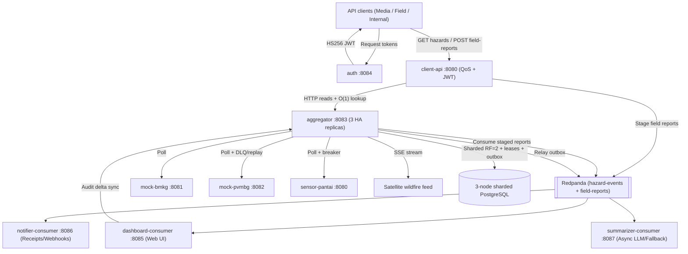

# BNPB Disaster Coordination Platform

A distributed-systems course project that aggregates earthquake, tsunami-warning, volcanic, wildfire, coastal-buoy, and field-report hazards into a single coordinated API and event stream.

Built for **IF4031 — Arsitektur Aplikasi Terdistribusi**, the project models a disaster-coordination platform for Indonesia's **Badan Nasional Penanggulangan Bencana (BNPB)**. The local application uses simulated agency feeds; it is an educational prototype, not an operational emergency-warning service.

## What it does

- **Combines heterogeneous data sources.** Polls simulated BMKG earthquake/tsunami feeds, PVMBG volcanic reports, and `sensor-pantai` coastal buoy observations, streams live satellite wildfire detections over SSE (`SATELIT`), and ingests authenticated field reports via Redpanda (`bnpb.field-reports`).
- **Enriches, quarantines, and shards state.** Enriches volcano metadata from a static catalog, stores dynamic attributes in PostgreSQL JSONB, routes records across a 3-shard (`RF=2`) PostgreSQL topology with anti-entropy repair and Audit API verification, and parks incompatible PVMBG payloads in `dlq_messages` with policy-gated replay.
- **Controls access and protects critical traffic.** Issues short-lived HS256 JWTs (`hazards:read:summary` vs `hazards:read:all`), enforces priority QoS load shedding on the gateway (`HTTP 429` for `media` under saturation while reserving capacity for `field`/`internal`), and isolates field-report idempotency.
- **Separates ingestion from downstream consumers.** A transactional outbox publishes canonical hazard payloads to Redpanda, driving a Web Analytics Dashboard UI, an update-aware Notifier with JSONL receipts and webhooks, and a non-blocking AI Situation Summarizer with deterministic extractive fallback.
- **Degrades gracefully during failures.** Reads stay served from reachable canonical shards during upstream or partial storage outages with explicit `degraded` / `partial` metadata, coordinated through storage-clock leader leases and monotonic fencing tokens.

## Architecture

The application has eight independent Go modules. Services communicate through HTTP or Kafka-compatible messaging, rather than importing one another's code. Only the Aggregator accesses canonical PostgreSQL storage.



| Component | Responsibility |
| :--- | :--- |
| [Aggregator](services/aggregator/README.md) | Upstream pollers (BMKG, PVMBG, coastal), satellite SSE streaming, field-report consumer, sharded `RF=2` persistence, HA leasing/fencing, internal + Audit APIs, and outbox relay |
| [Auth](services/auth/README.md) | Client authentication, HS256 JWT issuance, and refresh-token rotation |
| [Client API](services/client-api/README.md) | Public HTTP API, JWT/scope checks, priority QoS load shedding, field-report staging to Redpanda, and field projection |
| [Mock BMKG](services/mock-bmkg/README.md) | Simulated seismic events and tsunami warnings |
| [Mock PVMBG](services/mock-pvmbg/README.md) | Simulated volcanic reports, schema evolution modes (`additive`, `rename_field`, `type_change`, `missing_required_field`), latency, and outages |
| Sensor Pantai (`sensor-pantai`) | External pinned coastal buoy observation simulator deployed in Compose and Kubernetes |
| [Consumers](services/consumers/README.md) | Independent consumer groups: Analytics Web UI (`dashboard-consumer`), receipt/webhook alert engine (`notifier-consumer`), and non-blocking AI summarizer (`summarizer-consumer`) |

**Stack:** Go 1.22, standard-library HTTP servers, PostgreSQL 16 with `pgx`, Redpanda with `kafka-go`, and HS256 JWTs with `jwt/v5`.

## Try it locally

You need Docker Engine and Docker Compose v2. Git is needed to clone the repository; Go is only needed to run tests or services outside Docker.

```bash
git clone https://github.com/Darsua/AAT.git
cd AAT
cp .env.example .env
docker compose up -d --build
```

Populate all required empty secret placeholders in `.env` before starting Compose. Neither `.env.example` nor `docker-compose.yml` ships usable credential defaults. Keep `.env` out of version control and do not expose local development ports on an untrusted network.

Check startup and the public API's health:

```bash
docker compose ps
curl --fail http://localhost:8080/health
```

The mocks start with historical reports and generate new ones every ten seconds. Allow time for the first polling cycle before querying hazards. The [local development guide](docs/development.md) covers authentication, API examples, configuration, sharded Compose, and troubleshooting.

### Local endpoints

These are the default Compose addresses; host ports can be changed through configuration.

| Endpoint | Address |
| :--- | :--- |
| Hazard list & detail | `GET http://localhost:8080/api/v1/hazards`, `GET http://localhost:8080/api/v1/hazards/{id}` |
| Field-report submission | `POST http://localhost:8080/api/v1/field-reports` (alias `POST /field-reports`) |
| Token issuance & refresh | `POST http://localhost:8084/auth/token`, `POST http://localhost:8084/auth/refresh` |
| Dashboard web UI & API | `http://localhost:8085/dashboard`, `GET http://localhost:8085/api/analytics` |
| AI Situation Summarizer | `GET http://localhost:8087/summaries`, `GET http://localhost:8087/summaries/latest` |
| Aggregator (loopback only) | `GET http://localhost:8083/readyz`, `GET http://localhost:8083/internal/audit/checksum` |
| Mock BMKG / PVMBG | `http://localhost:8081`, `http://localhost:8082` |
| Kafka-compatible broker | `localhost:19092` |
| Prometheus / Tempo / Grafana | `http://localhost:9090`, `http://localhost:3200`, `http://localhost:3000` |

Hazard queries require a Bearer JWT. `fields=summary` is the default; `fields=all` requires the full-read scope. PostgreSQL has no published host port on the base stack. Check Aggregator readiness from host or inside Compose:

```bash
docker compose exec -T aggregator wget -qO- http://localhost:8083/readyz
```

Stop the stack while retaining its database and broker volumes:

```bash
docker compose down
```

**To delete local data as well**, use `docker compose down -v`. The `make down` shortcut also deletes those volumes.

## Project status

All eight Go services implement the M1 baseline plus the M2 feature set, with unit tests, repository checks, and 2026-11-20 / 2026-11-21 live 3-node Kubernetes evidence recorded in [`docs/evidence/m2/`](docs/evidence/m2/). Remaining M2 report authoring (`#32`) is tracked in [GitHub issues](https://github.com/Darsua/AAT/issues).

| Area | Current repository status |
| :--- | :--- |
| BMKG/PVMBG ingestion, gateway reads, JWT auth, and Kafka fan-out | Implemented and verified across unit tests and M1/M2 runs |
| Sharded canonical storage (`consistent_hash_64_vnodes`, `RF=2`, anti-entropy) and Audit API (`#23`, `#30`) | Implemented in `services/aggregator` with `make catalog-bench` and `make audit-verify`; live 3-node distribution recorded in [baseline evidence](docs/evidence/m2/p1-p4-baseline/README.md); see [ADR 006](docs/adr/006-sharded-storage-consistent-hashing-and-audit-api.md) |
| Aggregator HA (`replicas: 3`), storage-clock leases, monotonic fencing, and `/readyz` draining (`#25`) | Implemented and verified (`3 -> 5 -> 2` HA scaling, `kill-leader`, `kill-store`, `partition`, `wipe-node`); see [ADR 007](docs/adr/007-aggregator-ha-leader-leasing-and-fencing.md) |
| PVMBG schema-evolution policy, DLQ parking, and automated replay (`#26`) | Implemented in `mock-pvmbg` and `aggregator`; local rehearsal and live `schema` evidence recorded |
| Field-report writes, Satellite SSE, Coastal poller, Priority QoS, Analytics UI, AI Summarizer, Observability (`#24`, `#27`–`#29`, `#35`–`#37`) | Implemented across `client-api`, `aggregator`, `dashboard`, `notifier`, and `summarizer`; 10,000-VU QoS saturation, HPA scale-up/scale-down, and in-cluster Prometheus/Tempo/Grafana traces recorded ([ADR 008](docs/adr/008-non-blocking-ai-situation-summarizer.md)) |
| Kubernetes deployment (`k8s/base/`, `scripts/deploy_k8s.sh`) | Deployed on the 3-node cluster (`aqua`, `ruby`, `akane`) with NetworkPolicies, least-privilege `secretKeyRef`, `LimitRange`, and in-cluster Prometheus/Tempo/Grafana (`observability.yaml`) |

### Prototype limitations

- Auth refresh sessions (`services/auth`) remain process-local and single-replica; in-memory `client-api` idempotency and `notifier` receipt logs are node-local unless backed by shared/persistent storage.
- Default `docker compose up` runs single-node `canonical-db` and single-broker Redpanda; use [docker-compose.sharded.yml](docker-compose.sharded.yml) (`make up-sharded`) or [k8s/base/](k8s/base/) for the 3-node sharded and 3-replica HA Aggregator topology. Redpanda remains single-replica (`replicas: 1`) on K8s (`ruby`), and in-cluster Prometheus/Tempo/Grafana use ephemeral `emptyDir` storage.
- Final M2 report authoring (`#32`) remains tracked in GitHub issues.

## Explore the repository

| Location | Contents |
| :--- | :--- |
| [`services/`](services/) | Independent Go services and service-specific guides |
| [`contracts/`](contracts/) | Canonical JSON Schema and HTTP API specifications |
| [`docs/adr/`](docs/adr/) | Architecture decisions and their trade-offs |
| [`docs/development.md`](docs/development.md) | Local configuration, API usage, tests, and M1 verification commands |
| [`k8s/`](k8s/) | Kubernetes foundation manifests and the cluster operations runbook |
| [`scripts/`](scripts/) | Local demonstrations and load/observability checks |
| [`docs/evidence/`](docs/evidence/) | Milestone-separated evidence: historical M1 records and 2026-11-20 M2 cluster captures |
| [`docs/report/`](docs/report/) | M1 LaTeX report and reserved M2 report folders |
| [`docs/diagrams/`](docs/diagrams/) | Architecture and flow diagram sources |

For local checks, run `make test` with Go installed. See the development guide for vetting and Compose validation. Contributors should also read [`AGENTS.md`](AGENTS.md) for repository constraints and ownership rules.

## Authors and license

Developed by Darrel Adinarya Sunanda, Jennifer Khang, and Aldoy Fauzan Avanza. Licensed under [MIT](LICENSE).
