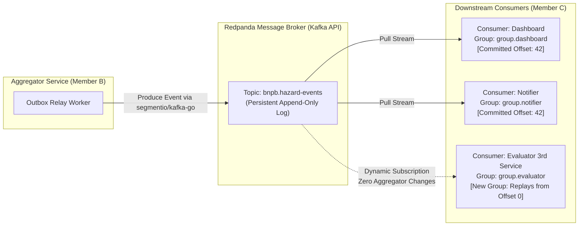

# ADR 002: Selecting Redpanda as Kafka-Compatible Message Broker for Event Fan-Out

---

## Context
Problem 5 of IF4031 Milestone 1 requires an event-driven architecture to broadcast canonical hazard alerts to multiple downstream consumers (such as field disaster dashboards and emergency SMS/alert dispatchers).

The core technical requirements under Problem 5 are:
1. **Pub-Sub Fan-Out**: Multiple downstream consumer services must receive identical copies of every published hazard event independently.
2. **At-Least-Once Delivery**: Events must not be lost if a consumer crashes or is temporarily offline.
3. **Consumer Downtime Recovery**: When an offline consumer restarts, it must automatically resume consumption from its last committed checkpoint without missing any historical events that arrived during its downtime.
4. **Dynamic Extensibility**: Evaluators will spin up an unexpected 3rd consumer service during grading; the broker and publisher must support this dynamic subscriber without requiring any code modifications, configuration changes, or restarts in the aggregator service.
5. **Resource Constraints**: The entire infrastructure must run smoothly in Docker Compose on a single machine alongside PostgreSQL and six application services.

---

## Decision
We select **Redpanda** (single-node development mode) as our message broker, interfaced exclusively via the pure Go **`segmentio/kafka-go`** client library.

* **Broker Container**: `redpandadata/redpanda:v24.1.1` configured with single-node mode (`--overprovisioned`, `--smp 1`, `--memory 256M`).
* **Topic**: `bnpb.hazard-events` (partitioned topic with durable commit log).
* **Go Client**: `github.com/segmentio/kafka-go` for both publishing in `aggregator` and consuming in `consumers/*`.
* **Consumer Groups**: Each consumer registers under a distinct, dedicated consumer group (e.g., `group.dashboard`, `group.notifier`, `group.third-party`).



---

## Rationale

### 1. Full Apache Kafka Protocol Compatibility Without JVM Overhead
Redpanda is a C++ reimplementation of the Apache Kafka wire protocol that requires zero JVM runtime and zero ZooKeeper or complex KRaft bootstrap orchestration.

| Dimension | Redpanda (Single Node) | Apache Kafka 3.7 (KRaft) | RabbitMQ 3.13 | NATS JetStream 2.10 |
| :--- | :--- | :--- | :--- | :--- |
| **Runtime / Engine** | Native C++20 (Seastar) | Java JVM (OpenJDK 21) | Erlang/OTP | Native Go |
| **Idle Memory Footprint** | **~65–95 MB** | 1.2–1.8 GB | ~120–180 MB | **~25–40 MB** |
| **Startup to Healthy** | **< 1.5 seconds** | 18–35 seconds | 8–15 seconds | < 1 second |
| **API Protocol** | Native Kafka API (v0.11+) | Native Kafka API | AMQP 0-9-1 / AMQP 1.0 | NATS Core / JetStream |
| **Consumer Group Offsets** | Built-in Kafka standard | Built-in Kafka standard | Manual ACK / Dead-Letter | JetStream Consumer State |
| **CGO-Free Go Driver** | Yes (`segmentio/kafka-go`) | No (`confluent` requires C) | Yes (`amqp091-go`) | Yes (`nats.go`) |

Traditional Apache Kafka routinely consumes >1.5 GB of RAM due to JVM heap allocations, causing severe memory pressure on developer laptops. Redpanda runs comfortably in under 100 MB of RAM while remaining 100% wire-compatible with standard Kafka tools, libraries, and offsets.

### 2. Pure Go Client (`segmentio/kafka-go`) Eliminating CGO
The official Confluent Kafka Go client (`confluent-kafka-go`) is a wrapper around `librdkafka`, a C library. This introduces severe build disadvantages:
* Requires CGO compilation (`CGO_ENABLED=1`), which requires installing GCC/musl in the Docker builder and complicates cross-compilation.
* Produces dynamically linked binaries that complicate minimal Alpine or scratch container deployments.
* Prone to silent segmentation faults during high-concurrency connection tear-downs.

In contrast, `segmentio/kafka-go` is written in 100% pure Go:
* Compiles cleanly with `CGO_ENABLED=0` into static binaries.
* Offers fine-grained control over connection dialers, context cancellations, and consumer group offset commits.
* Idiomatic Go error handling and context propagation.

### 3. Native Offset Management for Seamless Problem 5 Scenarios
Kafka's log-centric architecture is ideally suited for Problem 5:
* **Decoupled Consumer State**: Consumers maintain their own cursor position (`committed offset`) in the broker's `__consumer_offsets` topic. If `services/consumers/notifier` goes down for 30 seconds while `services/aggregator` ingests 10 new seismic alerts, the messages remain persistently stored in `bnpb.hazard-events`. When `notifier` boots back up, it asks Redpanda for its last committed offset and immediately receives all 10 unread messages in order.
* **Dynamic 3rd Consumer Addition**: Adding a new downstream consumer requires zero changes to the publisher. A new consumer simply connects with `group_id: "evaluator-audit-service"` and `auto_offset_reset: "earliest"`. Redpanda creates a new consumer cursor and replays the entire event log without impacting `group.dashboard` or `group.notifier`.

---

## Alternatives Evaluated

### Alternative A: Apache Kafka with KRaft
* **Description**: The official Apache Kafka container running in KRaft (metadata quorum) mode without ZooKeeper.
* **Why Rejected**: Cold-boot times exceed 25–35 seconds in Docker Compose, leading to frequent health check timeouts during CI and grading runs. Memory consumption sits at 1.5 GB minimum, leaving insufficient memory for concurrent load testing.

### Alternative B: RabbitMQ (AMQP 0-9-1)
* **Description**: Traditional message broker using Fanout Exchanges bound to individual queues per consumer.
* **Why Rejected**:
  * **Queue Management Overhead**: Supporting dynamic consumer addition in RabbitMQ requires dynamic queue declaration and binding logic, or manual broker management.
  * **Destructive Reads**: RabbitMQ removes messages from queues once acknowledged by default. Historical message replay for a new or restarted consumer requires complex Dead Letter Exchanges or dedicated replay streaming plugins (RabbitMQ Streams), which add architectural complexity.

### Alternative C: NATS JetStream
* **Description**: High-performance, lightweight Go message broker supporting stream persistence.
* **Why Rejected**: While NATS is lightweight and high-performing, Kafka's consumer group model is the explicit industry gold standard taught in IF4031. NATS JetStream introduces non-standard stream creation semantics and subject hierarchies that diverge from the standard Kafka consumer group offset terminology expected in grading rubrics.

---

## Consequences & Requirements

### 1. Mandatory Idempotent Consumer Processing
Kafka guarantees **at-least-once delivery**, meaning transient network retransmissions or consumer rebalances can cause a consumer to receive the same message twice.
* **Requirement**: All downstream consumers (`services/consumers/*`) must enforce idempotency:
  ```go
  // Consumer deduplication check
  if processedEvents.Contains(event.HazardID) {
      log.Printf("[CONSUMER] Duplicate event %s ignored", event.HazardID)
      return nil
  }
  processedEvents.Add(event.HazardID)
  ```
  In production, this is backed by a local Redis set or database table with a unique constraint on `hazard_id`.

### 2. Synchronous Outbox Relay Decoupling
To ensure that database transactions are not blocked by message broker network latency or transient broker outages, `services/aggregator` never publishes directly to Redpanda inside the HTTP request or polling transaction. Instead, it writes to an `outbox_events` table in PostgreSQL, which an asynchronous background relay publishes to Redpanda (see [ADR 003](file:///home/darrel/Projects/AAT/docs/adr/003-canonical-storage-postgres-jsonb.md)).
