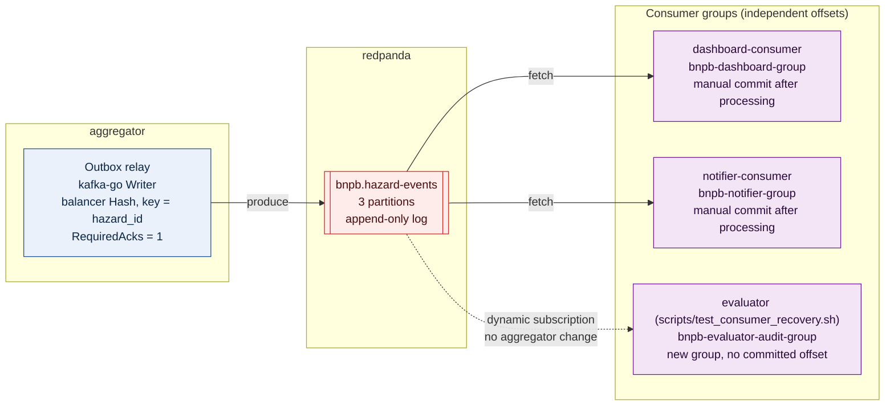

# ADR 002: Selecting Redpanda as Kafka-Compatible Message Broker for Event Fan-Out

---

## Context
Problem 5 of IF4031 Milestone 1 requires an event-driven architecture to broadcast canonical hazard alerts to multiple downstream consumers (such as field disaster dashboards and emergency SMS/alert dispatchers).

The core technical requirements under Problem 5 are:
1. **Pub-Sub Fan-Out**: Multiple downstream consumer services must receive identical copies of every published hazard event independently.
2. **At-Least-Once Delivery**: Events must not be lost if a consumer crashes or is temporarily offline.
3. **Consumer Downtime Recovery**: When an offline consumer restarts, it must automatically resume consumption from its last committed checkpoint without missing any historical events that arrived during its downtime.
4. **Dynamic Extensibility**: Evaluators will spin up an unexpected 3rd consumer service during grading; the broker and publisher must support this dynamic subscriber without requiring any code modifications, configuration changes, or restarts in the aggregator service.
5. **Resource Constraints**: The entire infrastructure must run smoothly in Docker Compose on a single machine alongside PostgreSQL and six application services.

---

## Decision
We select **Redpanda** (single-node development mode) as our message broker, interfaced exclusively via the pure Go **`segmentio/kafka-go`** client library.

* **Broker Container**: `docker.redpanda.com/redpandadata/redpanda:v24.1.1` configured with single-node mode (`--overprovisioned`, `--smp 1`, `--memory 256M`).
* **Topic**: `bnpb.hazard-events` (partitioned topic with durable commit log).
* **Go Client**: `github.com/segmentio/kafka-go` for both publishing in `aggregator` and consuming in `consumers/*`. The producer uses the `kafka.Hash` balancer on the message key, `RequiredAcks: kafka.RequireOne` (acks=1) and `MaxAttempts: 3`; consumers read with `FetchMessage`, commit manually with `CommitMessages`, and start from `kafka.FirstOffset` for a new group.
* **Consumer Groups**: Each consumer registers under a distinct, dedicated consumer group (currently `bnpb-dashboard-group` and `bnpb-notifier-group`, overridable via `CONSUMER_GROUP`; a third-party evaluator service would use its own, e.g. `bnpb-evaluator-audit-group` as in `scripts/test_consumer_recovery.sh`).
* **Message Envelope** (frozen contract between producer and consumers, detailed in `services/aggregator/README.md` §3.5): message **key** = `hazard_id`; message **value** = the canonical `HazardEvent` JSON object from `contracts/hazard_event.json` with no additional wrapper; optional `X-Correlation-ID` header for tracing.



---

## Rationale

### 1. Full Apache Kafka Protocol Compatibility Without a JVM Runtime
Redpanda is a C++ reimplementation of the Apache Kafka wire protocol that requires zero JVM runtime and zero ZooKeeper or complex KRaft bootstrap orchestration.

| Dimension | Redpanda (Single Node) | Apache Kafka 3.7 (KRaft) | RabbitMQ 3.13 | NATS JetStream 2.10 |
| :--- | :--- | :--- | :--- | :--- |
| **Runtime / Engine** | Native C++20 (Seastar) | Java JVM (OpenJDK 21) | Erlang/OTP | Native Go |
| **Idle Memory Footprint** | **352 MiB** (measured, `--smp 1 --memory 256M`) | 297 MiB (measured, `apache/kafka:3.7.0`, default single-node KRaft) | 147.5 MiB (measured, `rabbitmq:3.13`) | **7.4 MiB** (measured, `nats:2.10 -js`) |
| **Startup to Healthy** | **1.9 s** (measured: `docker start` until `rpk cluster health`) | 3.9 s (measured: until the broker answers API-versions) | 5.2 s (RabbitMQ log "Time to start") | Not measured precisely (image has no shell; up within a fixed 2 s probe) |
| **API Protocol** | Native Kafka API (v0.11+) | Native Kafka API | AMQP 0-9-1 / AMQP 1.0 | NATS Core / JetStream |
| **Consumer Group Offsets** | Built-in Kafka standard | Built-in Kafka standard | Manual ACK / Dead-Letter | JetStream Consumer State |
| **CGO-Free Go Driver** | Yes (`segmentio/kafka-go`) | No (`confluent` requires C) | Yes (`amqp091-go`) | Yes (`nats.go`) |

*Measured on 2026-10-10: Docker 29.8.2, 13.5 GiB host RAM, single sample, idle about 45 s to 2 min after the service was ready. Raw figures and method are in [`docs/adr-audit.md`](../adr-audit.md), section E. Python and other third-party figures come from minimal stand-ins (a hello-world FastAPI app; stock images with default settings), not from BNPB services.*

In this measurement Redpanda did **not** use less idle memory than Apache Kafka in KRaft mode (352 MiB versus 297 MiB), although it started faster (1.9 s versus 3.9 s, both small). Memory and startup time are therefore not the reasons for choosing Redpanda. The reasons that remain are: it speaks the Kafka wire protocol so `segmentio/kafka-go` and Kafka tooling work unchanged, it runs as a single native binary without a JVM, and its `rpk` CLI is used by the `redpanda-init` service to provision and verify the topic.

### 2. Pure Go Client (`segmentio/kafka-go`) Eliminating CGO
The official Confluent Kafka Go client (`confluent-kafka-go`) is a wrapper around `librdkafka`, a C library. This introduces severe build disadvantages:
* Requires CGO compilation (`CGO_ENABLED=1`), which requires installing GCC/musl in the Docker builder and complicates cross-compilation.
* Produces dynamically linked binaries that complicate minimal Alpine or scratch container deployments.
* Prone to silent segmentation faults during high-concurrency connection tear-downs.

In contrast, `segmentio/kafka-go` is written in 100% pure Go:
* Compiles cleanly with `CGO_ENABLED=0` into static binaries.
* Offers fine-grained control over connection dialers, context cancellations, and consumer group offset commits.
* Idiomatic Go error handling and context propagation.

### 3. Native Offset Management for Seamless Problem 5 Scenarios
Kafka's log-centric architecture is ideally suited for Problem 5:
* **Decoupled Consumer State**: Consumers maintain their own cursor position (`committed offset`) in the broker's `__consumer_offsets` topic. If `services/consumers/notifier` goes down for 30 seconds while `services/aggregator` ingests 10 new seismic alerts, the messages remain persistently stored in `bnpb.hazard-events`. When `notifier` boots back up, it asks Redpanda for its last committed offset and immediately receives all 10 unread messages in order.
* **Dynamic 3rd Consumer Addition**: Adding a new downstream consumer requires zero changes to the publisher. A new consumer simply connects with a new group id (the demo script `scripts/test_consumer_recovery.sh` uses `bnpb-evaluator-audit-group`) and starts from the earliest offset (`auto_offset_reset: "earliest"`, `kafka.FirstOffset` in `kafka-go`). Redpanda creates a new consumer cursor and replays the entire event log without impacting `bnpb-dashboard-group` or `bnpb-notifier-group`.

---

## Alternatives Evaluated

### Alternative A: Apache Kafka with KRaft
* **Description**: The official Apache Kafka container running in KRaft (metadata quorum) mode without ZooKeeper.
* **Why Rejected**: Apache Kafka in KRaft mode is a viable alternative here: measured at 3.9 s to ready and 297 MiB idle (613 MB image versus 581 MB for Redpanda). It was not selected because it adds a JVM runtime and offers no functional advantage for a single-node, single-machine deployment; the choice is a preference for a smaller operational surface, not a resource constraint.

### Alternative B: RabbitMQ (AMQP 0-9-1)
* **Description**: Traditional message broker using Fanout Exchanges bound to individual queues per consumer.
* **Why Rejected**:
  * **Queue Management Overhead**: Supporting dynamic consumer addition in RabbitMQ requires dynamic queue declaration and binding logic, or manual broker management.
  * **Destructive Reads**: RabbitMQ removes messages from queues once acknowledged by default. Historical message replay for a new or restarted consumer requires complex Dead Letter Exchanges or dedicated replay streaming plugins (RabbitMQ Streams), which add architectural complexity.

### Alternative C: NATS JetStream
* **Description**: High-performance, lightweight Go message broker supporting stream persistence.
* **Why Rejected**: While NATS is lightweight and high-performing, Kafka's consumer group model is the explicit industry gold standard taught in IF4031. NATS JetStream introduces non-standard stream creation semantics and subject hierarchies that diverge from the standard Kafka consumer group offset terminology expected in grading rubrics.

---

## Consequences & Requirements

### 1. Mandatory Idempotent Consumer Processing
Kafka guarantees **at-least-once delivery**, meaning transient network retransmissions or consumer rebalances can cause a consumer to receive the same message twice.
* **Requirement**: All downstream consumers (`services/consumers/*`) must enforce idempotency:
  ```go
  // Consumer deduplication check
  if processedEvents.Contains(event.HazardID) {
      log.Printf("[CONSUMER] Duplicate event %s ignored", event.HazardID)
      return nil
  }
  processedEvents.Add(event.HazardID)
  ```
  **Milestone 1 status:** the pseudo-code above is illustrative. The implemented consumers keep a process-local `map[string]struct{}` guarded by a mutex (`services/consumers/dashboard/main.go`, `services/consumers/notifier/main.go`), which is reset on restart and is not shared between replicas (see [ADR 005](005-stateless-architecture-and-m2-readiness.md)). Backing it with a Redis set or a database table with a unique constraint on `hazard_id` is a Milestone 2 requirement before running more than one replica per group.

### 2. Synchronous Outbox Relay Decoupling
To ensure that database transactions are not blocked by message broker network latency or transient broker outages, `services/aggregator` never publishes directly to Redpanda inside the HTTP request or polling transaction. Instead, it writes to an `outbox_events` table in PostgreSQL, which an asynchronous background relay publishes to Redpanda (see [ADR 003](003-canonical-storage-postgres-jsonb.md)).
