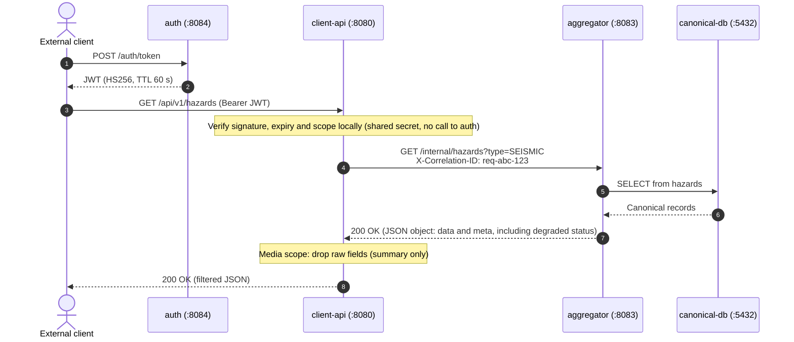

# ADR 004: Internal Service-to-Service Communication via HTTP/REST with Decoupled Abstractions

---

## Status and scope

This describes the M1 HTTP read path. The broader M2 contracts frozen in [#34](https://github.com/Darsua/AAT/issues/34) are not all implemented: field-report writes ([#27](https://github.com/Darsua/AAT/issues/27), Jenka), satellite/coastal types ([#28](https://github.com/Darsua/AAT/issues/28), Aldoy; [#29](https://github.com/Darsua/AAT/issues/29), Jenka), audit ([#30](https://github.com/Darsua/AAT/issues/30), Darrel), and unified observability ([#35](https://github.com/Darsua/AAT/issues/35), Jenka) remain future work.

## Context
In IF4031 Milestone 1, services must communicate across network boundaries:
1. **Aggregator to External Providers**: `services/aggregator` periodically polls `mock-bmkg` (`:8081`) and `mock-pvmbg` (`:8082`) over HTTP.
2. **Client-Facing API to Aggregator**: When external clients query `services/client-api` (`GET /api/v1/hazards`), the client API validates the caller's JWT token, evaluates required scopes, and forwards the query to `services/aggregator` (`GET /internal/hazards`) over the internal Docker network.
3. **Problem 1 Live Dynamic Attributes**: Upstream attributes (e.g., `confidence_level`) must flow seamlessly across internal service boundaries without manual schema recompilation or dropping unmapped fields.
4. **Grading & Operability**: Evaluators need to inspect internal states, simulate outages, and test endpoints directly via command-line tools (`curl`, `jq`, `httpie`).

We evaluated the choice of internal communication protocol between `client-api` and `aggregator`.

---

## Decision
We select **HTTP/1.1 with JSON payloads (REST)** for all internal synchronous service-to-service communication, coupled with an **interface-driven domain abstraction (`HazardService`)** inside `client-api`:

1. **Protocol**: HTTP/1.1 over Docker bridge network (`bnpb-internal`), using Go standard library `net/http` with connection keep-alive and tuned connection pools (`http.Transport`).
2. **Endpoint**: `http://aggregator:8083/internal/hazards` supports query filters (`since`, `type`, `severity`, `limit`, `offset`) and returns a JSON **`{data, meta}` object**, including degradation metadata. Only Aggregator accesses canonical PostgreSQL. The public gateway also implements `GET /api/v1/hazards/{id}` by scanning this list in pages of 500, not through an internal get-by-ID HTTP route.
3. **Header Propagation**: `client-api` generates or propagates `X-Correlation-ID` across all internal HTTP calls for distributed tracing.
4. **Interface Decoupling**: Handlers in `client-api` never reference raw HTTP client details; they interact with a domain interface:
   ```go
   type HazardService interface {
       GetHazards(ctx context.Context, filter QueryFilter) (*HazardResponse, error)
   }
   ```
   `RemoteAggregatorClient` implements this interface. It isolates list transport details; it does not guarantee future M2 writes, new types, or lookup semantics can be implemented without handler changes.



---

## Rationale

### 1. Protocol Homogeneity Across Architecture
The course specification explicitly mandates HTTP/REST for external integrations:
* BMKG and PVMBG mock endpoints must be exposed as HTTP/REST.
* `auth` provides client-credential JWT issuance and refresh rotation over HTTP; this is not a claim of a complete OAuth2 server.
* `client-api` is an HTTP REST gateway.

Using HTTP/REST internally preserves uniform transport semantics across the entire platform. Every service uses the same Go `net/http` primitives, error handling patterns, status codes (`200`, `400`, `401`, `403`, `503`), and connection lifecycle management.

### 2. Seamless Dynamic Attribute Serialization (Problem 1)
JSON is inherently schemaless and naturally accommodates dynamic additive attributes.
* In Go, dynamic JSON attributes map directly into `map[string]interface{}` without code generation.
* PVMBG's custom decoder captures unknown additive fields (e.g., `confidence_level`) and normalization places them in `attributes`; JSONB and the HTTP clients preserve that dynamic map through to `fields=all` responses. Summary projection intentionally omits raw attributes.
* This is **not** an all-upstream guarantee: BMKG uses typed DTOs that drop unknown fields. JSON transport by itself does not provide unknown-field capture.

### 3. Grading Transparency and Terminal Operability
Evaluators assess services by executing tests, inspecting containers, and running shell commands. With REST:
* The internal Aggregator endpoint can be inspected with an HTTP client on the Compose network; inspection tooling need not be bundled into each runtime image.
* Every payload is human-readable JSON. There is no need to install specialized binary decoding tools (`grpcurl`), mount `.proto` files, or maintain reflection servers.

### 4. Low Latency on Docker Bridge Network
HTTP/1.1 with persistent keep-alive connections (`MaxIdleConns: 100`, `MaxIdleConnsPerHost: 50`) met the project latency target: in the Milestone 1 load test through the full client-api to aggregator path, p95 latency was 3.43 ms and p99 6.48 ms for BMKG-only requests, and 3.42 ms and 6.72 ms for volcanic requests ([P2 load-test log](../evidence/m1/p2/load_test.log)). This demonstrates that HTTP/1.1 is sufficient for the measured 50-VU workload. No direct benchmark against a gRPC implementation was performed.

---

## Alternatives Evaluated

### Alternative A: gRPC with Protocol Buffers (Protobuf)
* **Description**: Define `.proto` service contracts and compile client/server stubs with `protoc`.
* **Why Rejected**:
  * **Dynamic Schema Friction (Problem 1)**: Protobuf enforces strict static schemas. Handling unexpected dynamic fields requires wrapping payloads in `google.protobuf.Struct` or `google.protobuf.Any`, which introduces cumbersome boilerplate and type reflection in Go (`structpb.NewValue(...)`), negating gRPC's static type safety advantages.
  * **Toolchain & Build Overhead**: Requires adding `protoc` compilers and Go protobuf plugins into Dockerfiles, increasing container build times and workspace complexity.
  * **CLI Inconvenience**: Internal endpoints cannot be inspected with standard `curl`.

### Alternative B: Broker Request-Reply (RPC over Kafka/Redpanda)
* **Description**: `client-api` publishes a request to a Kafka request topic and awaits a response on a dedicated reply topic with a correlation ID.
* **Why Rejected**:
  * Request-reply over an asynchronous event log is an anti-pattern for synchronous read queries (`GET /api/v1/hazards`).
  * Introduces unnecessary latency, complex timeout handling, and potential consumer group rebalancing stalls during synchronous user requests.
  * Event brokers should be reserved for decoupled event fan-out (Problem 5), not synchronous query-response loops.

---

## Clean Domain Decoupling

The actual `HazardService`, `QueryFilter`, and `RemoteAggregatorClient` live in [client-api/main.go](../../services/client-api/main.go), not a separate shared domain package. The client uses a 5-second timeout, up to 100 idle connections (50 per host), and a 90-second idle timeout.

This abstraction is a seam for changing list retrieval, not a promise of zero handler/model changes for new endpoints, scopes, or types. M2 resilience and performance choices remain open ([ADR 005](005-stateless-architecture-and-m2-readiness.md)).
