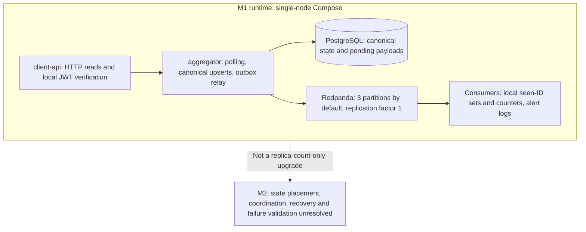
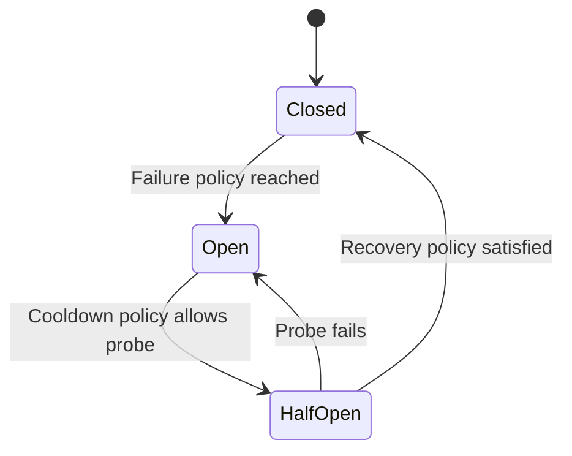

# ADR 005: Stateless Service Architecture and Milestone 2 Readiness

## Status and chronology

**M1 baseline; Aggregator M2 sharding (`#23`), Audit API (`#30`), and HA leasing (`#25`) implemented.** This ADR originated with the 2026-09-22 scaffold and was aligned with the M1 implementation on 2026-10-10. For the implemented M2 sharded storage engine and HA leader-leasing architecture in `services/aggregator`, see [ADR 006](006-sharded-storage-consistent-hashing-and-audit-api.md) and [ADR 007](007-aggregator-ha-leader-leasing-and-fencing.md). [GitHub issues](https://github.com/Darsua/AAT/issues) track remaining cross-service M2 tasks (gateway write APIs, external sensors, shared auth sessions, and live 3-node cluster verification).

[Historical measurements](../evidence/m1/adr-audit/README.md) do not establish multi-node capacity or failure guarantees.

## M1 state and limitations

M1 runs six logical service areas as seven independent Go modules in single-node Compose. Some request handling is stateless, but the platform as a whole is not:

- **Gateway:** `client-api` verifies HS256 JWTs locally and reads through Aggregator HTTP. Get-by-ID scans list pages of 500, rather than using an indexed internal HTTP lookup.
- **Auth:** configured client credentials issue access JWTs (default TTL 60 seconds). Refresh rotation/replay revocation is process-local: restart loses sessions and replicas cannot share them. Refresh revocation does not invalidate already-issued access JWTs before expiry if the verification key stays unchanged.
- **Consumers:** unbounded process-local hazard-ID sets and counters reset on restart. The sets suppress legitimate later updates as well as duplicates; committed broker offsets may survive. Dashboard/notifier behavior is counters and logged decisions, not a UI or notification delivery.
- **Ingestion:** Aggregator bootstraps each process-local cursor from the latest stored `occurred_at` and polls with a 10-second overlap. This is not a durable source checkpoint: late/backdated records, partial processing, source retention, and failed bootstrap/persistence can leave gaps. Mocks also keep generated records and chaos toggles in memory and reload seeds on restart.
- **Persistence and delivery:** deterministic source-based IDs and `UNIQUE (source, source_ref_id)` avoid duplicate canonical rows, not conflicting revisions or multi-replica coordination. Canonical state and the latest outbox payload commit atomically; pending revisions can coalesce. Leased relay claims allow retry but also replay after publish-before-completion failure ([ADR 003](003-canonical-storage-postgres-jsonb.md)).
- **Broker:** three partitions by default, replication factor one, producer acks=1. At-least-once retry depends on surviving storage and recovering dependencies. Catch-up depends on retention and committed offsets; this is neither event sourcing nor node-loss durability ([ADR 002](002-message-broker-redpanda.md)).

## Open M2 design questions

1. **Which state must survive and be shared?** Define refresh-session recovery and revision-aware consumer projections/idempotency, separating replay from legitimate updates. Define durable audit records separately from the mutable outbox. No Redis or other state-store technology is selected here.
2. **How will nodes coordinate and recover?** Define shard routing/query fan-out, transaction/outbox ownership, poll checkpoints/backfill, conflict handling, relay leases, and failover. Replica placement, readiness/routing, database/broker redundancy, acknowledgment policy, and failure tests need an explicit design. Existing Kubernetes foundation files are not a complete application deployment.
3. **What are the ordering and recovery boundaries?** Retain the frozen `hazard_id` Kafka key. Hash affinity assumes a fixed partition count; retries/concurrent relays do not guarantee revision/event-time order. Partition count and retention need workload/recovery targets, not an assumed six-partition topology.
4. **Which resilience measures are justified?** Define deadlines, retry budgets, overload behavior, and freshness indicators, then measure before choosing caching, rate limiting, or circuit breaking. No `gobreaker`, cache TTL, or breaker threshold is selected. M1 already decouples reads from polling and uses timeout/backoff with process-local degraded-source tracking; a polling breaker alone would not provide query fallback.

The following is an **optional conceptual breaker model**, not implemented poller behavior or a selected M2 dependency. Failure/recovery policies, cooldowns, probes, and HA interaction remain open.

## Continuity and acceptance boundary

Preserve independent modules, Aggregator-only canonical storage ownership, frozen contracts, UTC timestamps, and correlation propagation. New sources, write APIs, analytics, audit, and observability extend this baseline; their implementation belongs in the linked issues. The HTTP `HazardService` seam does not promise new behavior without handler/model changes ([ADR 004](004-internal-communication-rest.md)).

M2 claims require implementation and multi-node failure/recovery evidence. M1 measurements, retained offsets, uniqueness constraints, or extra replicas alone do not establish complete restart progress, durable analytics, exactly-once effects, or node-loss availability.
