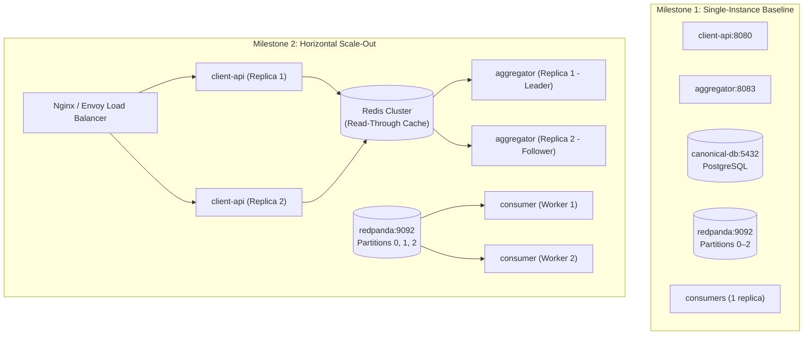

# ADR 005: Stateless Service Architecture and Milestone 2 Scalability Roadmap

---

## Context
IF4031 is structured across progressive milestones. Milestone 1 establishes the baseline distributed architecture (six services, canonical storage, broker event fan-out, authentication scopes, and resilience under basic failure). Milestone 2 expands the platform to handle:
* **Horizontal multi-instance scaling** across compute services.
* **Volume spikes and high-throughput traffic bursts**.
* **Cascading failures and network partitions** requiring circuit breaking and fallback strategies.
* **Cache layers and distributed rate limiting**.

Authoritative state should live in durable infrastructure before services are scaled horizontally. Milestone 1 may use bounded process-local state where the trade-off is explicit, but that state must be externalized before running multiple replicas.

---

## Decision
We keep the synchronous read path stateless, delegate canonical data and message offsets to `canonical-db` and `redpanda`, adopt **time-ordered UUIDv7 identifiers**, enforce **database-level idempotency constraints**, and decouple services via **domain interfaces**. The Milestone 1 Auth refresh-token store and consumer deduplication/counters are documented exceptions that must move to durable shared storage before those services are horizontally scaled.



---

## Stateless Request Paths and Explicit Milestone 1 Exceptions

### 1. Request and Session State
* **`client-api`**: Holds no local state. Authentication is verified statelessly via cryptographic signature verification on self-contained JWT tokens (HMAC-SHA256 with 60-second expiration). Any incoming request can be served by any `client-api` container replica.
* **`auth`**: Issues signed JWTs containing user identities and a `scope` claim (`hazards:read:summary` or `hazards:read:all`; see `contracts/auth_api.yaml`). Access-token verification requires only the shared verification key. Refresh-token rotation is process-local in Milestone 1, so an Auth restart invalidates outstanding refresh tokens and multiple Auth replicas would require a shared Redis or database store.
* **Consumers**: Redpanda durably stores committed offsets, but the current deduplication sets and dashboard counters are process-local. They are sufficient for the single-replica Milestone 1 baseline; durable idempotency and counters must be externalized before multi-replica deployment.
* **`aggregator`**: Polling cursors and ingestion timestamps are committed transactionally to `canonical-db`. Restarting or replicating the aggregator does not lose cursor progress.

### 2. Time-Ordered Identifiers (UUIDv7)
Traditional sequential auto-increment integer IDs (`SERIAL`) require central database sequences, causing contention during high-concurrency inserts across distributed instances. Traditional random UUIDv4 identifiers cause B-Tree index fragmentation and poor cache locality.
* **Solution**: We adopt **UUIDv7** for all `hazard_id` generation. UUIDv7 combines a 48-bit millisecond Unix timestamp with 74 bits of cryptographically random data:
  ```
  018e6e5b-3b4e-7b3b-8f3a-2a1c9e8d4f00
  |--- Timestamp ---|-- Ver --|-- Rand --|
  ```
* **Advantages**:
  * Globally unique and generated locally in Go with zero database round-trips.
  * Monotonically increasing: Maintains sequential B-Tree append locality, maximizing PostgreSQL insert performance and reducing table bloat.

### 3. Database-Level Idempotency Guarantees
To prevent duplicate records during network retries or multi-instance polling, idempotency is enforced at the storage engine level:
```sql
CONSTRAINT uq_source_ref UNIQUE (source, source_ref_id)
```
Ingestion queries utilize atomic upserts (`ON CONFLICT (source, source_ref_id) DO UPDATE ...` or `DO NOTHING`). Even if multiple worker routines or replicas poll the same event simultaneously, duplicate records can never enter the canonical store.

---

## Milestone 2 Evolution Path

### 1. Multi-Instance Horizontal Scaling
* **`client-api` Scaling**:
  * Because `client-api` is 100% stateless, scaling from 1 to N instances requires only setting `deploy.replicas: N` in Docker Compose or Kubernetes, fronted by an Nginx or Envoy reverse proxy with round-robin routing.
* **Consumer Group Auto-Rebalancing**:
  * Kafka/Redpanda automatically rebalances partitions when multiple instances share a consumer group. Before scaling the current consumers, their process-local deduplication and side-effect state must move to shared durable storage so a rebalance or restart cannot repeat a non-idempotent action.

### 2. Traffic Spikes and Read-Through Caching
* During major disaster events, read queries on `GET /hazards` spike exponentially.
* In Milestone 1, `client-api` uses the decoupled `HazardService` interface (see [ADR 004](004-internal-communication-rest.md)):
  ```go
  type HazardService interface {
      GetHazards(ctx context.Context, filter QueryFilter) (*HazardResponse, error)
  }
  ```
* In Milestone 2, we introduce Redis read-through caching via a simple decorator pattern with **zero changes to HTTP handlers**:
  ```go
  type CachedHazardService struct {
      next  HazardService
      redis *redis.Client
  }

  func (c *CachedHazardService) GetHazards(ctx context.Context, filter QueryFilter) (*HazardResponse, error) {
      cacheKey := generateFilterKey(filter)
      if cached, err := c.redis.Get(ctx, cacheKey).Bytes(); err == nil {
          var resp HazardResponse
          json.Unmarshal(cached, &resp)
          return &resp, nil
      }
      resp, err := c.next.GetHazards(ctx, filter)
      if err == nil {
          c.redis.Set(ctx, cacheKey, resp, 5*time.Second)
      }
      return resp, err
  }
  ```

### 3. Fault Tolerance & Circuit Breaking
Problem 2 introduces external provider outages (e.g., PVMBG downtime).
* In Milestone 1, `aggregator` gracefully returns the last-known canonical state with a `degraded: true` and `stale_since` indicator.
* In Milestone 2, we wrap external HTTP polling with a **Circuit Breaker** (e.g., `sony/gobreaker`):
  ```mermaid
  stateDiagram-v2
      [*] --> Closed
      Closed --> Open: Consecutive Failures > Threshold (e.g. 5)
      Open --> HalfOpen: Cooldown Timer Expires (e.g. 30s)
      HalfOpen --> Closed: Probe Request Succeeds
      HalfOpen --> Open: Probe Request Fails
  ```
  * **Closed State**: Requests flow normally to `mock-pvmbg`.
  * **Open State**: Immediate fallback to canonical cache; prevents polling worker threads from exhausting sockets or thundering-herd effects on recovering providers.
  * **Half-Open State**: Canary probe sent to verify provider recovery.

### 4. Topic Partitioning & High Throughput
In Milestone 1, `bnpb.hazard-events` uses three partitions provisioned by the one-shot `redpanda-init` Compose service. For Milestone 2:
* Increase partitions from 3 to 6.
* Partition messages by key (`Key: []byte(event.HazardType)` or `Key: []byte(event.AreaName)`).
* Guarantees strict chronological ordering per hazard category while enabling 6 concurrent consumer workers per group.

---

## Summary of Architectural Continuity

| Architecture Aspect | Milestone 1 Foundation | Milestone 2 Evolution | Code Changes Required |
| :--- | :--- | :--- | :--- |
| **Identity Generation** | UUIDv7 (time-ordered) | Distributed UUIDv7 | None |
| **Data Idempotency** | PostgreSQL Unique Constraints | Distributed Deduplication Table | None |
| **Client Gateway** | Single stateless `client-api` | N instances behind Envoy | Compose configuration only |
| **Auth Refresh State** | Process-local rotation store | Shared Redis or database store | Replace refresh-token store |
| **Consumer Scaling** | Single worker per group with process-local deduplication | Multi-worker consumer group with shared idempotency state | Externalize deduplication and side effects |
| **Query Acceleration** | Direct DB indexing | Redis decorator on `HazardService` | Add 1 decorator struct |
| **Provider Outages** | Polling retry + Degraded flag | Dynamic Circuit Breaker | Add wrapper in polling client |
