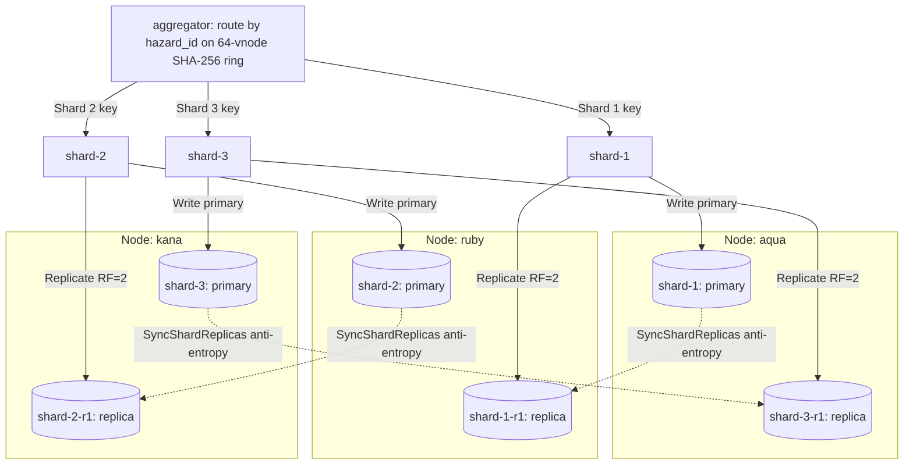

# ADR 006: Sharded Canonical Storage Engine, Consistent Hashing, and Internal Audit API

---

## Status and scope

**Accepted and implemented in Aggregator (`#23`, `#30`).** Extends the single-node PostgreSQL baseline in [ADR 003](003-canonical-storage-postgres-jsonb.md) and resolves the storage-sharding and audit questions in [ADR 005](005-stateless-architecture-and-m2-readiness.md). Core implementation resides in [sharding.go](../../services/aggregator/internal/repository/sharding.go), [hazard_repo.go](../../services/aggregator/internal/repository/hazard_repo.go), [audit_handler.go](../../services/aggregator/internal/api/audit_handler.go), [catalog-loader](../../services/aggregator/cmd/catalog-loader/main.go), and [verify_audit_and_catalog.py](../../scripts/verify_audit_and_catalog.py). Multi-node live cluster chaos testing waits on physical 3-node Kubernetes evaluation.

---

## Context

In Milestone 1, `services/aggregator` relied on a single `canonical-db` PostgreSQL container. That design had three structural limits for Milestone 2:

1. **Single Node Storage Ceiling & Fault Blast Radius (`#23`)**: A single node stored 100% of canonical records. Losing that node or wiping its volume halted writes and erased state until manual restoration.
2. **Regional Hotspots During Seismic Spikes**: Natural earthquakes cluster in space and time (for example, rapid West Java aftershock swarms). Partitioning naively by province/region or upstream agency concentrates writes on a single shard during an active emergency.
3. **Verifiable Cross-Shard Auditability (`#30`)**: External verification harnesses require deterministic cursor pagination, byte-exact SHA-256 checksums across sources, primary/replica node inspection, and explicit degraded reporting (`partial: true`, `unavailable_units`) instead of silent omissions or HTTP 500 failures.

---

## Decision

We partition canonical state across **three logical shards (`shard-1`, `shard-2`, `shard-3`) with cross-node replication factor 2 (`RF=2`)** across worker nodes `aqua`, `ruby`, and `kana`, coordinated solely by `services/aggregator`:

1. **Consistent Hash Ring (`ConsistentHashRing`)**: Routes every `HazardEvent` deterministically by `hazard_id` using a big-endian 64-bit SHA-256 ring with **64 virtual nodes (`defaultVirtualNodes = 64`)** per logical shard.
2. **Asymmetric Ring-Shifted Cross-Node Placement (`RF=2`)**: No single worker node hosts both the primary and replica of the same shard, and no single node holds 100% of canonical records:
   - `aqua`: `shard-1` (primary) + `shard-3-r1` (replica)
   - `ruby`: `shard-2` (primary) + `shard-1-r1` (replica)
   - `kana`: `shard-3` (primary) + `shard-2-r1` (replica)
3. **Degraded Write Tolerance & Anti-Entropy (`SyncShardReplicas`)**: Writes target both the primary and replica units of the owning shard concurrently. If one unit is offline, the write succeeds on the surviving unit and marks the missed unit stale (`staleUnits`). Authoritative reads skip stale units until `SyncShardReplicas` reconciles missed rows ordered by higher `fencing_token`, newer `occurred_at`, and earlier `ingested_at`.
4. **Online Cluster Rebalancing (`RebalanceCluster`)**: When shards are added or removed, `RebalanceCluster` builds a replacement consistent hash ring, migrates moved records to their new owners, and deletes obsolete copies from former owners only after destination persistence succeeds.
5. **Internal Audit API (`AuditHandler`)**: Serves `/internal/audit/events`, `/internal/audit/checksum`, `/internal/audit/location`, and `/internal/audit/unprocessed` behind constant-time Bearer token auth (`AUDIT_TOKEN`), returning deterministic `(ingested_at ASC, hazard_id ASC)` scatter-gather results, base64url keyset cursors, raw-byte sorted `source_ref_id` SHA-256 checksums (`\n`-delimited, no trailing newline), and unit/node placement status distinguishing proven `404 not_found` from unreachable shard `503`.

---

## Placement Strategy Trade-Offs and Measured Skew (`#23`)

Evaluating `cmd/catalog-loader --in-memory --json` (`make catalog-bench`) across **709 deterministic events** (500 multi-region historical BMKG events across 12 Indonesian tectonic zones, 200 regional spike events concentrated in `"Jawa Barat - Cekungan Bandung"`, and 9 multi-source companion events from `PVMBG`, `SATELIT`, and `SENSOR_PANTAI`):

### Per-Node Storage and Write Distribution

| Worker Node | Primary Records | Replica Records | Unique Events Held | Primary Share | Unique Event Coverage | Baseline Writes | Spike Writes |
| :--- | :---: | :---: | :---: | :---: | :---: | :---: | :---: |
| `aqua` (`shard-1`, `shard-3-r1`) | 239 | 236 | 475 | 33.71% | 67.00% | 350 | 125 |
| `kana` (`shard-3`, `shard-2-r1`) | 236 | 234 | 470 | 33.29% | 66.29% | 330 | 140 |
| `ruby` (`shard-2`, `shard-1-r1`) | 234 | 239 | 473 | 33.00% | 66.71% | 338 | 135 |

No node holds 100% of primary rows (max `33.71%`) or unique canonical events even with `RF=2` replicas counted (max `67.00%`).

### Comparative Placement Evaluation

| Placement Strategy | Full Catalog (`709` events): Counts by Shard (`1 / 2 / 3`) | Full Skew Ratio (`max / avg`) | Regional Spike (`200` events): Counts by Shard (`1 / 2 / 3`) | Spike Skew Ratio (`max / avg`) | Rejection / Adoption Outcome |
| :--- | :---: | :---: | :---: | :---: | :--- |
| **`ConsistentHashByHazardID` (`64` vnodes)** | `239 / 234 / 236` | **`1.011`** | `60 / 75 / 65` | **`1.125`** | **Selected.** Immune to regional/agency hotspots while preserving direct single-shard `hazard_id` lookups. |
| **`RegionHashByAreaName` (`hash(area_name) % N`)** | `336 / 48 / 325` | `1.422` | `0 / 0 / 200` | `3.000` | Rejected. Concentrates 100% of a regional seismic swarm onto `shard-3`. |
| **`AgencyPartitionBySource` (`hash(source) % N`)** | `0 / 703 / 6` | `2.975` | `0 / 200 / 0` | `3.000` | Rejected. Ties shard utilization directly to BMKG event volume (`700/709` events). |

The main trade-off of `hazard_id`-keyed consistent hashing is that agency-filtered or time-range audit queries must scatter-gather across all primary/surviving shards (`scatterGatherHazards`). With three shards queried in parallel under bounded `2500ms` per-unit read timeouts, scatter-gather overhead stays small relative to the write-skew protection it buys.

---

## Verification

- **Unit & Simulation Tests ([sharding_test.go](../../services/aggregator/internal/repository/sharding_test.go), [audit_handler_test.go](../../services/aggregator/internal/api/audit_handler_test.go))**: Verified ring distribution (`TestShardedRepository_DistributionAndNoNodeHoldsAll`), regional spike skew (`TestComparePlacementStrategies_RegionalSpikeSkew`), tie-breaker ordering, full wipe + second-node loss recovery (`TestShardedRepository_WorkerWipeSurvivalRecoveryRebalanceAndSecondLoss`), and Audit API behavior under `go test -race`.
- **Cross-Language Parity (`make audit-verify`)**: Independently verified Go `ComputeAuditChecksum` digests against Python's raw-byte `\n`-joined SHA-256 calculation across `ALL`, `BMKG`, `PVMBG`, `SATELIT`, and `SENSOR_PANTAI`, alongside multi-page cursor pagination and shard/replica placement checks.
