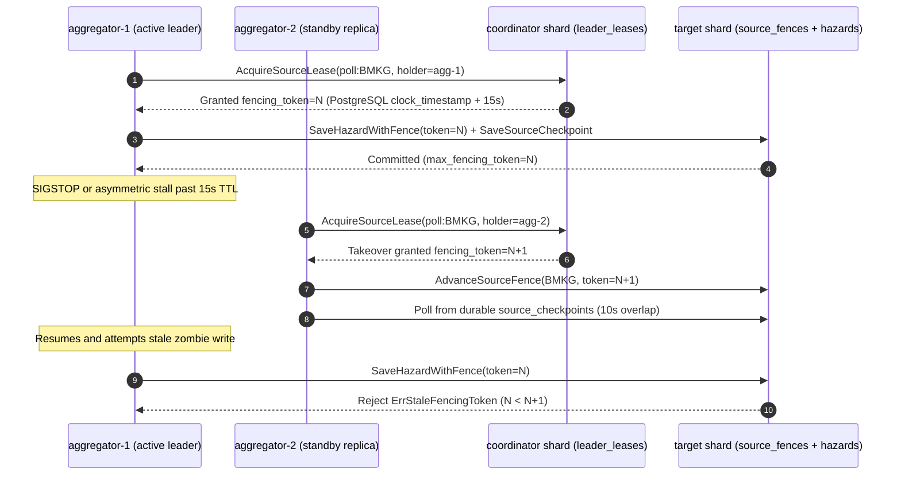

# ADR 007: High-Availability Aggregator Replicas, Leader Leasing, and Fencing Tokens

---

## Status and scope

**Accepted and implemented in Aggregator (`#22`, `#25`).** Extends the single-aggregator polling model in [ADR 005](005-stateless-architecture-and-m2-readiness.md) to a multi-replica Deployment (`replicas: 3` in [aggregator.yaml](../../k8s/base/aggregator.yaml) and `aggregator`, `aggregator-2`, `aggregator-3` in [docker-compose.sharded.yml](../../docker-compose.sharded.yml)). Core implementation resides in [fencing.go](../../services/aggregator/internal/repository/fencing.go), [poller.go](../../services/aggregator/internal/worker/poller.go), [health.go](../../services/aggregator/internal/api/health.go), and [001_init.sql](../../services/aggregator/migrations/001_init.sql). Live Kubernetes `SIGSTOP` and rolling-drain drills wait on 3-node cluster evaluation.

---

## Context

Scaling `services/aggregator` horizontally introduces two coordination hazards if multiple replicas run identical pollers concurrently:

1. **Duplicate Ingestion & Lost Progress**: Uncoordinated pollers overwrite each other's cursors and hammer upstream agency APIs concurrently. If a leader crashes or is rolled during a Kubernetes update, a standby must resume polling without skipping intermediate events.
2. **Split-Brain & Process Pauses (`SIGSTOP`) Under Clock Skew**: A paused leader (`SIGSTOP`) or stalled VM can wake up after its lease expires and attempt to commit stale hazard writes or checkpoints after a new leader has already taken over. Application container clocks on separate worker nodes can also drift relative to each other (e.g., `+45s` vs `-30s`), making local Go `time.Now()` TTL checks unsafe.

---

## Decision

We coordinate per-source polling exclusivity inside the existing sharded PostgreSQL tier using **storage-clock leases, strictly monotonic fencing tokens, durable checkpoints, and graceful readiness draining**:

1. **Storage-Clock Leader Leases (`leader_leases`)**:
   - Each upstream source acquires its own fine-grained lease key (`poll:BMKG`, `poll:PVMBG`) backed by PostgreSQL's `clock_timestamp()` (`LEASE_TTL_SECS=15`, `LEASE_RENEW_INTERVAL_SECS=5`), avoiding reliance on application node clocks.
   - Coordinator selection prefers shard-1's primary unit and falls back automatically to shard-1's replica (`coordinatorUnits()`) when the coordinator primary is unavailable, reconciling split leases via `reconcileCoordinatorLease` once the failed primary returns.
2. **Monotonic Fencing Tokens (`source_fences`, `hazards.fencing_token`)**:
   - Every new lease acquisition or handoff allocates a strictly increasing `fencing_token` greater than both `leader_leases.fencing_token` and `source_fences.max_fencing_token`.
   - `SaveHazardWithFence` and `SaveSourceCheckpoint` validate the caller's token inside the storage write transaction and reject any zombie write whose `fencing_token` is below the shard's `source_fences.max_fencing_token` or an existing record's `fencing_token`, returning `ErrStaleFencingToken`.
3. **Durable Source Checkpoints (`source_checkpoints`)**:
   - Checkpoints record `(source, last_occurred_at, last_source_ref_id, fencing_token, holder_id)` after each successful cycle and apply monotonically so `last_occurred_at` never regresses on failover.
   - Newly promoted leaders resume from `last_occurred_at - 10s` (overlap safety window paired with idempotent upserts on `(source, source_ref_id)`).
4. **Voluntary Release & Readiness Draining**:
   - On `SIGINT` or `SIGTERM`, `HealthHandler.SetDraining(true)` immediately flips `GET /health` to HTTP `503` so Kubernetes Ingress stops routing new traffic.
   - Polling workers stop cleanly and invoke `ReleaseSourceLease` so a standby can take over immediately without waiting the full 15s TTL, and the process waits `DRAIN_DELAY_MS` (`3000ms` in K8s/sharded Compose) before closing active HTTP connections.

---

## Trade-Offs and Alternatives

| Option Evaluated | Outcome | Rationale under Cluster Constraints |
| :--- | :--- | :--- |
| **PostgreSQL `leader_leases` + `source_fences` (Chosen)** | **Adopted** | Reuses existing shard-1 primary/replica (`aqua` / `ruby`), avoids deploying an extra HA consensus cluster inside Appendix B memory caps, and enforces fencing atomically alongside hazard rows. |
| **Kubernetes `Lease` API (`coordination.k8s.io`) alone** | Rejected | Handles leader election, but Kubernetes API resource versions do not travel to PostgreSQL rows to reject zombie writes after a `SIGSTOP` pause without a storage-side fencing check. |
| **Dedicated `etcd` / Redis cluster** | Rejected | Introduces an additional quorum service that consumes extra memory and must itself be replicated across `aqua`, `ruby`, and `kana`. |

---

## Verification

- **Lease & Fencing Suites ([fencing_test.go](../../services/aggregator/internal/repository/fencing_test.go), [worker_test.go](../../services/aggregator/internal/worker/worker_test.go))**: Verified exclusive lease acquisition/renewal and graceful handoff (`TestLeaderLease_ExclusiveAcquisitionRenewalAndFailover`), stale paused-leader write rejection (`TestFencing_FrozenLeaderRejectedAtStorage`), `+45s` vs `-30s` clock skew resilience (`TestFencing_ClockSkewPlus45sAndMinus30s`), coordinator primary failover and disk wipe reconciliation (`TestLeaderLease_CoordinatorPrimaryFailoverAndWipeRecovery`), and multi-replica zero-gap poller handoff (`TestMultiReplicaBMKGPoller_ExclusiveCollectionAndZeroGapFailover`).
- **Drain Probe Coverage ([hazard_handler_test.go](../../services/aggregator/internal/api/hazard_handler_test.go))**: Verified `HealthHandler.SetDraining(true)` switches `GET /health` from `200` to `503`.
