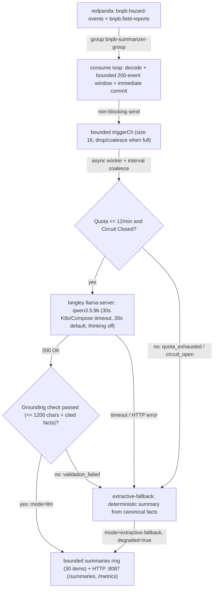

# ADR 008: Non-Blocking AI-Native Disaster Situation Summarizer

---

## Status and scope

**Accepted and implemented in Consumers (`#36`).** Adds `summarizer-consumer` (`bnpb/consumer-summarizer`) as a standalone asynchronous Go consumer in [services/consumers/summarizer/](../../services/consumers/summarizer/), wired into [docker-compose.yml](../../docker-compose.yml) and [apis-and-consumers.yaml](../../k8s/base/apis-and-consumers.yaml). All frozen files in [contracts/](../../contracts/) remain unchanged.

---

## Context

Optional Milestone 2 bonus `#36` requires multi-hazard situational summaries grounded in canonical events across all four upstream sources (`BMKG`, `PVMBG`, `SATELIT`, `SENSOR_PANTAI`) and optional staged field reports (`bnpb.field-reports`), while preserving strict operational guarantees:

1. **Zero Warning-Path Interference**: Canonical ingestion (`services/aggregator`), broker fan-out, and critical alert delivery (`services/consumers/notifier`) must remain unaffected when the LLM endpoint stalls, times out, fails, or hits quota limits.
2. **Storage Ownership Boundary**: Only `services/aggregator` may connect to canonical PostgreSQL storage. The summarizer must consume canonical events asynchronously from Redpanda without querying PostgreSQL.
3. **Bounded Memory & Backpressure**: Sudden ingestion bursts (or high-load scenarios under `#31`) cannot cause unbounded goroutine growth, heap blowup, or Kafka consumer lag stalls.

---

## Decision

We implement `summarizer-consumer` as an isolated Kafka consumer group (`bnpb-summarizer-group`) running a decoupled producer-consumer pipeline inside a `128Mi` request / `256Mi` memory-limit container:

1. **Local Model Selection & LAN Endpoint**: Uses self-hosted `qwen3.5:9b` (`Qwen3.5-9B-Q4_K_M` via Vulkan/MoltenVK) running on lab host **`langley` / `imac-gpu`** (`10.5.24.125`, Intel Core iMac with AMD Radeon Pro 5500 XT 8 GiB VRAM, macOS `launchd` unit `works.sister.llama-server` on `:11434`, also fronted externally behind Cloudflare Zero Trust Access at `https://ai.sister.works`). Measured LAN throughput from cluster workers is `~73.1 tok/s` prompt evaluation and `~25.5 tok/s` generation. Running inside the `10.5.24.0/22` campus LAN eliminates external SaaS latency and per-token billing variability. `AI_API_KEY` is stored exclusively in `Secret/bnpb-credentials` (never committed). HTTP calls use an explicit `Proxy: nil` transport so ambient node proxy variables never interfere with LAN inference traffic, and disable chain-of-thought tokens when `AI_DISABLE_THINKING=true` (`chat_template_kwargs.enable_thinking=false`; process default `AI_MAX_TOKENS=160`, deployed K8s/Compose default `AI_MAX_TOKENS=120`).
2. **Non-Blocking Kafka Loop & Bounded State**: `consume()` decodes `HazardEvent` messages, updates a bounded `MAX_RECENT_EVENTS=200` rolling window, commits offsets immediately, and sends on a buffered `triggerCh` (`SUMMARY_QUEUE_SIZE=16`, coalesced across `SUMMARY_MIN_INTERVAL_MS`: process default `2000`, deployed K8s/Compose default `15000`) with a non-blocking `default` branch that increments `coalesced_total` under load. Summaries snapshot the top `5` freshest events (`e.snapshotRecentEvents(5)`) and are stored in a bounded ring buffer (`MAX_SUMMARIES=30`) in RAM with no database dependency.
3. **Quota Budget, Circuit Breaker & Extractive Fallback**:
   - Sliding-window rate limiter enforces `AI_MAX_CALLS_PER_MIN=12`.
   - Per-request HTTP timeout (process default `AI_TIMEOUT_MS=20000`, deployed K8s/Compose default `AI_TIMEOUT_MS=30000`) and failure-threshold circuit breaker (`AI_CB_FAILURE_THRESHOLD=3`, process default `AI_CB_COOLDOWN_SECS=30`, deployed K8s/Compose default `AI_CB_COOLDOWN_SECS=45`) isolate upstream stalls.
   - Output grounding validator rejects empty, over-length (`>1200` runes), or ungrounded completions that fail to cite any active `hazard_id`, `source`, or `area_name` (`validation_failed`).
   - Whenever the AI path is disabled, timed out, quota-exhausted, circuit-open, or rejected by grounding validation, `buildDeterministicFallback` immediately emits a factual extractive summary across active regional clusters (`generator_mode: "extractive-fallback"`, `degraded: true`, explicit `degraded_reason`).
4. **Truthful Labeling & Telemetry**: All inspection responses on `/summaries` and `/summaries/latest` (`PORT=8087`) carry `generated: true` and an explicit `advisory_disclaimer`. Prometheus counters/gauges are exposed at `GET /metrics`.

---

## Trade-offs Considered

| Option Evaluated | Outcome | Rationale |
| :--- | :--- | :--- |
| **Isolated Kafka Consumer + Local `qwen3.5:9b` + Extractive Fallback** | **Adopted** | Zero PostgreSQL coupling, zero warning-path blocking, bounded RAM/queue, zero per-token cloud spend, and immediate graceful degradation on overload. |
| **Inline LLM Call in Aggregator / Notifier Pipeline** | Rejected | Violates non-blocking early-warning isolation; slow or unavailable inference would stall alert fan-out. |
| **Cloud SaaS LLM API** | Rejected | Introduces external internet dependency, variable egress latency, and per-token billing exposure inside load/chaos drills. |

---

## Verification and Limitations

- **Unit & Concurrency Suite ([main_test.go](../../services/consumers/summarizer/main_test.go))**: Verified multi-source extraction (`BMKG`, `PVMBG`, `SATELIT`, `SENSOR_PANTAI`, field reports), regional compound-cluster correlation, bounded window eviction, LLM grounding validation, non-blocking 50-message burst ingestion under a stalled 350ms server (`<100ms`), timeout-to-circuit-open transitions, quota exhaustion fallback, and `/health`, `/summaries`, `/summaries/latest`, `/metrics` HTTP handlers (`go test -race`).
- **Known Limitations**: Summaries reside in bounded in-memory buffers (`30` entries) and reset on pod restart; cross-source `BMKG`, `PVMBG`, `SATELIT`, and `SENSOR_PANTAI` correlation is verified live in [p1-p4-baseline](../evidence/m2/p1-p4-baseline/README.md).
