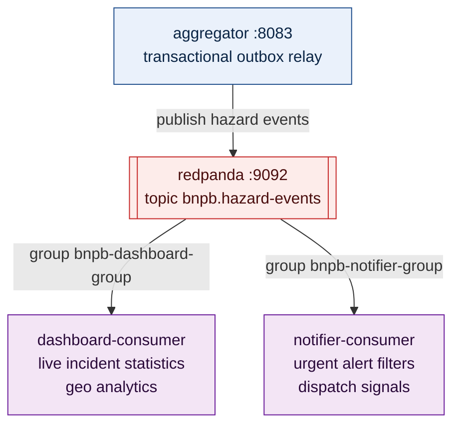

# Pub-Sub Consumers: Dashboard & Emergency Notifier

**Assigned Owner:** Member C (Jenka)  
**Parent Directory:** `services/consumers/`  
**Dependencies:** `github.com/segmentio/kafka-go`  
**Broker:** Redpanda (`redpanda:9092`)  
**Topic:** `bnpb.hazard-events`  

---

## 1. Architecture Overview

The BNPB platform uses an asynchronous Publish-Subscribe model backed by Redpanda (Kafka-compatible event store) to decouple real-time disaster alerts from downstream processing systems.

> [!IMPORTANT]
> **Message envelope (frozen, see `services/aggregator/README.md` §3.5):** the Kafka message **key** is the `hazard_id` string, and the message **value** is the canonical `HazardEvent` JSON object exactly as defined in `contracts/hazard_event.json` — no wrapper or envelope object around it. Unmarshal the raw message value directly into your `HazardEvent` struct. An optional `X-Correlation-ID` header may be present for tracing.



---

## 2. Consumer Group Specifications

The specification mandates at least **2 independent downstream consumer services** with distinct consumer groups. Here are the recommended reference consumer roles (which you can structure, name, and implement as you see fit under `services/consumers/`):

### 2.1 `bnpb-dashboard-group` (Reference: e.g. `dashboard/`)
- **Role:** Ingests all hazard events to update live situational awareness dashboards, aggregation counts, and historical geo-visualizations.
- **Processing Characteristics:** Bulk throughput, resilient to brief rendering delays.

### 2.2 `bnpb-notifier-group` (Reference: e.g. `notifier/`)
- **Role:** Real-time alerting engine. Filters incoming hazards for critical criteria (e.g. Earthquakes M ≥ 6.0, Tsunami Warnings, Volcano Alert Level `AWAS`/`SIAGA`).
- **Processing Characteristics:** Low latency, triggers emergency dispatches (SMS gateway, Webhooks, Push notifications) to BNPB field teams.

> [!IMPORTANT]
> Because each service uses an independent Consumer Group ID (`bnpb-dashboard-group` vs `bnpb-notifier-group`), Redpanda tracks separate offset pointers for each group. Downtime or processing slowness in one service does not starve the other. Root `docker-compose.yml` already registers both consumers; their group IDs can be overridden through environment variables when needed.

---

## 3. Deduplication & Idempotency Requirements

Because the aggregator uses an **At-Least-Once** outbox delivery mechanism, consumer failures or broker rebalances can deliver duplicate messages.

Consumers must guarantee **Idempotent Processing**:
1. **Deterministic Unique Key:** Extract canonical event ID `event.HazardID` (JSON: `hazard_id`) or composite key `event.Source + ":" + event.SourceRefID`.
2. **Deduplication Store:** Before executing non-idempotent actions (such as sending an SMS to rescue teams or incrementing an incident counter):
   - Check if `event.HazardID` has already been marked as processed in an in-memory set (with LRU/TTL expiration) or Redis `SETNX event:<hazard_id> 1 EX 86400`.
   - If present: Skip side-effect execution and commit the message offset immediately.
   - If new: Execute side-effect and mark the ID as processed.

---

## 4. Downtime Recovery Testing Procedure

The implementation uses the Compose services `dashboard-consumer` and
`notifier-consumer`, with the independent groups `bnpb-dashboard-group` and
`bnpb-notifier-group`.

To prove fault tolerance and message durability, execute a verification runbook equivalent to this:

### Step 1: Start Up Infrastructure
```bash
# From workspace root (with docker compose)
docker compose up -d redpanda canonical-db aggregator <your-consumer-1> <your-consumer-2>
```

### Step 2: Verify Initial Healthy Streaming
Verify both consumer containers are connected to Redpanda topic `bnpb.hazard-events` and actively reading.
```bash
docker compose logs -f <your-consumer-1>
docker compose logs -f <your-consumer-2>
```

### Step 3: Simulate Consumer Downtime
Stop one consumer container to simulate a service crash or maintenance window:
```bash
docker compose stop <your-consumer-1>
```

### Step 4: Ingest Events While Consumer is Down
Generate or poll new hazard events through `aggregator`:
```bash
# Trigger an event ingestion in aggregator or wait for poller cycle
# Check Redpanda topic lag for consumer groups (from host use port 19092):
rpk group describe <your-consumer-group-1> --brokers localhost:19092
rpk group describe <your-consumer-group-2> --brokers localhost:19092
```
*Expected Result:*
- The still-running consumer's group lag remains **0** (actively processing and logging dispatches).
- The stopped consumer's group lag **accumulates** (messages are safely buffered on the partition log).

### Step 5: Recover the Offline Consumer
Restart the stopped container:
```bash
docker compose start <your-consumer-1>
docker compose logs -f <your-consumer-1>
```

### Step 6: Verify Recovery & No Skipped Messages
1. Confirm the consumer reconnects with its original `GroupID`.
2. Confirm it resumes reading from the **last committed offset** (no messages skipped).
3. Confirm all backlogged events are processed and committed.
4. Check group lag returns to **0**:
```bash
rpk group describe <your-consumer-group-1> --brokers localhost:19092
```

---

## 5. Development Runbook

### Environment Variables
| Variable | Suggested Default | Description |
|---|---|---|
| `REDPANDA_BROKERS` | `localhost:19092` (host) or `redpanda:9092` (Docker) | Comma-separated broker endpoints |
| `TOPIC` | `bnpb.hazard-events` | Target topic — must match whatever `KAFKA_TOPIC_HAZARDS` resolves to for the aggregator (see root `.env.example`); not independently configurable per-consumer |
| `CONSUMER_GROUP` | e.g. `bnpb-dashboard-group` / `bnpb-notifier-group` | Unique consumer group identifier — pick any distinct IDs per consumer |

### Running Locally
```bash
# Run first consumer (e.g. dashboard)
cd services/consumers/dashboard
export REDPANDA_BROKERS="localhost:19092"
export TOPIC="bnpb.hazard-events"
export CONSUMER_GROUP="bnpb-dashboard-group"
export PORT="8085"   # health endpoint: GET /health
go run .

# In a separate terminal, run second consumer (e.g. notifier)
cd services/consumers/notifier
export REDPANDA_BROKERS="localhost:19092"
export TOPIC="bnpb.hazard-events"
export CONSUMER_GROUP="bnpb-notifier-group"
export PORT="8086"   # health endpoint: GET /health
go run .
```

### Build Docker Images (example layout)
```bash
docker build -t bnpb/consumer-dashboard:latest services/consumers/dashboard/
docker build -t bnpb/consumer-notifier:latest services/consumers/notifier/
```

---

## 6. Implementation Checklist for Jenka

- [x] Create independent `dashboard` and `notifier` Go modules and register them in `go.work`.
- [x] Implement JSON unmarshaling into canonical `HazardEvent` models matching `contracts/hazard_event.json`.
- [x] Implement in-memory idempotency keyed by `hazard_id`.
- [x] Implement dashboard counters by hazard type and severity.
- [x] Implement notifier rules for M ≥ 6.0, Tsunami SIAGA/AWAS, and Volcano AWAS.
- [x] Commit valid messages only after successful processing with `CommitMessages`.
- [x] Log, skip, and explicitly commit malformed messages so one poison message cannot block a consumer group.
- [x] Add non-root Dockerfiles and root Compose wiring for both consumer groups.
